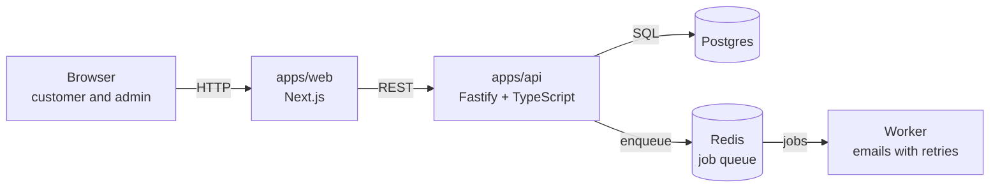

# reservas-app

[](https://github.com/MartinezBruno/reservas-app/actions/workflows/ci.yml)

Online booking for small businesses (hair salons, clinics, sports courts). The business sets up its services, staff and working hours, and customers book a free slot without creating an account.

The core requirement: **two bookings can never take the same slot**, even when two customers click "book" at the same millisecond.

> **Status: work in progress.** The monorepo base is in place (stage 0 of 8). The booking features described below are being built stage by stage; see [Roadmap](#roadmap).

## Technical challenges

These are the problems the project is built around. Each one will be documented in [`docs/decisions.md`](docs/decisions.md) as it is solved.

1. **No double bookings under concurrency.** "Check if free, then insert" has a race condition. The guarantee comes from the database: a Postgres exclusion constraint over `tstzrange`, backed by a test that fires concurrent requests for the same slot and checks that only one wins.
2. **Availability engine.** Free slots are working hours minus time blocks minus existing bookings, split into intervals of the service's length. This is a pure function with no I/O, unit-tested on its edge cases.
3. **Time zones.** Instants are stored in UTC (`timestamptz`) and always shown in the business's time zone.
4. **Background email.** Confirmation emails go through a queue (BullMQ + Redis) with retries, and jobs are idempotent: a job that runs twice does not send two emails.

## Architecture



The web app never talks to the database directly: everything goes through the API. Emails are not sent inside the request; the API enqueues a job and a separate worker processes it. The worker and the queue are planned for a later stage.

## Stack

| Area       | Choice                                        |
| ---------- | --------------------------------------------- |
| Monorepo   | pnpm workspaces                               |
| API        | Fastify 5, TypeScript                         |
| Web        | Next.js (App Router), Tailwind CSS            |
| Validation | Zod schemas shared in `packages/shared`       |
| Database   | Postgres 18                                   |
| Queue      | BullMQ + Redis 8                              |
| Tests      | Vitest (unit and API), Cypress (planned)      |
| Tooling    | ESLint (type-aware), Prettier, GitHub Actions |

The reasoning behind each choice is in [`docs/decisions.md`](docs/decisions.md).

## Getting started

**Requirements:** Node 24 (see `.nvmrc`), pnpm 12 (the exact version is pinned in `package.json`) and Docker.

```bash
git clone git@github.com:MartinezBruno/reservas-app.git
cd reservas-app
pnpm install
docker compose up -d   # Postgres and Redis
pnpm dev               # API on http://localhost:3001, web on http://localhost:3000
```

Check that the API is up:

```bash
curl http://localhost:3001/health
```

Copying `.env.example` to `.env` is optional: Docker Compose falls back to the same local development values when it is missing.

## Scripts

Run from the repo root:

| Command           | What it does                                 |
| ----------------- | -------------------------------------------- |
| `pnpm dev`        | Starts the API and the web app in watch mode |
| `pnpm test`       | Runs all Vitest projects once                |
| `pnpm test:watch` | Runs Vitest in watch mode                    |
| `pnpm lint`       | ESLint across the repo                       |
| `pnpm typecheck`  | TypeScript in every package                  |
| `pnpm format`     | Formats with Prettier                        |
| `pnpm build`      | Builds every package                         |

To run a single test project: `pnpm test --project api` (or `shared`).

CI runs `format:check`, `lint`, `typecheck`, `test` and `build` on every pull request.

## Project structure

```
apps/
  api/        Fastify API (the only service that talks to Postgres)
  web/        Next.js app: public booking flow and admin panel
packages/
  shared/     Zod schemas and types shared by api and web
docs/
  decisions.md  Technical decisions: what was chosen, what was ruled out, and why
```

## Roadmap

- [x] **0. Repo base:** monorepo, Docker Compose, lint, tests, CI
- [ ] **1. Data model:** migrations and seed data
- [ ] **2. Availability engine:** pure function and `GET /businesses/:slug/availability`
- [ ] **3. Bookings without double booking:** exclusion constraint, concurrency test, `409 Conflict`
- [ ] **4. Auth and admin API:** login for owner and staff, permissions
- [ ] **5. Frontend:** public booking flow and admin calendar
- [ ] **6. Background email:** queue with retries, idempotent jobs
- [ ] **7. Quality and deploy:** Cypress e2e, OpenAPI docs, public demo
